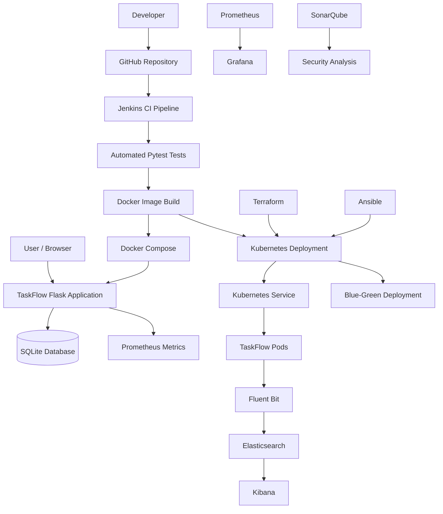

# TaskFlow – System Architecture

## Architecture Diagram

## Architecture Notes

- GitHub stores source code and DevOps configuration.
- Jenkins performs checkout, dependency installation, automated tests and Docker image building.
- Docker Compose runs the local application and supporting services.
- Kubernetes provides orchestration, services and persistent storage.
- Terraform provisions Kubernetes resources using a reusable module.
- Ansible provides configuration management and deployment automation.
- Prometheus and Grafana provide monitoring.
- Fluent Bit, Elasticsearch and Kibana provide centralized logging.
- SonarQube supports static code analysis.
- Blue-Green deployment configuration is maintained in Kubernetes manifests.
- ArgoCD is not included in this diagram because repository-managed GitOps configuration has not yet been verified.
